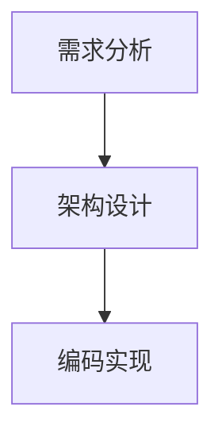
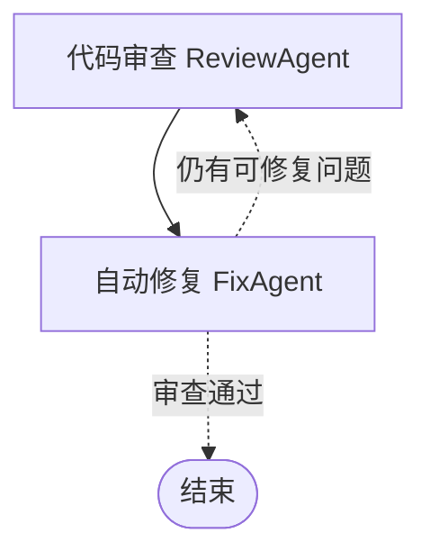

# Design.md —— HW2-Workflow 设计文档

> SE2026 课程实践 · 作业二（Homework 2）
> Simple Workflow MVP：多 Agent 协作的 Workflow 编排

---

## 1. 总体架构

采用**分层 + 插件式节点**设计，引擎与 Agent 完全解耦：

```
┌─────────────────────────────────────────────────────────────┐
│  flows.py        两条演示流程（Mini SE / 审查修复）            │
│  ── 组装 Agent 与 Workflow，定义流程拓扑与循环条件              │
├─────────────────────────────────────────────────────────────┤
│  agents.py       5 个 Agent 节点                              │
│  ── RequirementAgent / DesignAgent / CodingAgent              │
│     ReviewAgent / FixAgent（离线 + 在线双模式）                │
├─────────────────────────────────────────────────────────────┤
│  engine.py       Workflow 引擎（纯编排，不感知 Agent 内部）     │
│  ── Node(叶子) / Branch(分支) / Loop(循环) / Parallel(并行)    │
│  ── 重试、错误策略（raise/continue）、Mermaid 导出             │
├─────────────────────────────────────────────────────────────┤
│  core.py         基础设施                                      │
│  ── Message / MessageBus（Agent 间通信）                       │
│  ── SharedState（黑板模式状态共享）                            │
│  ── EventLog（执行日志与状态追踪）                             │
│  ── BaseAgent（Agent 基类：订阅路由 + 异常兜底）               │
├─────────────────────────────────────────────────────────────┤
│  codeagent/      复用自 HW1                                   │
│  ── LLMClient（OpenAI 兼容客户端，指数退避重试）               │
│  ── OfflineEngine（ast 规则审查引擎）                          │
│  ── ToolRegistry（读文件/列目录/运行代码/搜索）                │
└─────────────────────────────────────────────────────────────┘
```

**关键设计决策**：引擎只依赖"节点是可调用对象 + 读写 `SharedState`"这一契约，
因此新增 Agent 只需写一个类并 `wf.add("名字", agent_instance)` 即可入流程——
这是满足评分标准中"可扩展性（20%）"的核心手段。

---

## 2. 核心机制

### 2.1 Agent 间通信：MessageBus（发布/订阅）

- 每个 Agent 通过 `subscribe_to(topic)` 订阅关心的消息类型；
- 上游 Agent 执行后通过 `bus.publish(Message(...))` 广播产出，总线投递给订阅者并记录全部历史；
- 消息历史落盘为 `*_messages.json`，作为"Agent 间通信"的实证；
- **接收侧适配**：业务逻辑写在 `execute(state)`，总线回调统一走
  `WorkflowAgentBase.process(message, state=None)`——它把消息 payload 里的上游产物
  铺进共享状态、执行本 Agent，再把结果作为回复消息发出。没有这层适配，
  订阅者会直接抛 `NotImplementedError`，总线就成了"只记账不投递"。

### 2.2 状态管理：SharedState（黑板模式）

- 全局唯一黑板，节点通过 `set/get` 读写，引擎自动记录每次变更的来源与时间；
- **数据流约定**：上游节点的返回值由引擎写入约定的 key（如 `requirements` / `design` / `code`），下游节点从同一 key 读取——顺序流程的"隐式管道"；
- 运行结束导出 `*_state.json` 快照，供追踪与复现。

### 2.3 执行日志与状态追踪：EventLog

- 记录五类事件：`node_start` / `node_end` / `iteration` / `error` / `message`，含时间戳与节点名；
- **迭代进度用独立的 `iteration` 事件**，不与 `node_end` 混用，保证日志里的父子节点时序可信；
- `EventLog.live = True` 时事件会实时打印到控制台（CLI 默认开启），长流程不会看起来"卡死"；
- 支持导出文本（`to_text`）与 JSON（`to_json`）；
- 每个节点的耗时在 `node_end` 中体现（毫秒级）。

### 2.4 流程控制

引擎提供四种结构节点，可自由组合：

| 结构 | 类 | 语义 | 在演示中的用途 |
|------|----|------|----------------|
| 顺序 | `Node` + `Workflow.steps` | 依次执行，产出写入状态 | Mini SE 的需求→设计→代码 |
| 条件分支 | `Branch` | `condition(state)` 为真走 then，否则走 else（可为空跳过） | 单元测试覆盖；可按审查结果走不同后续 |
| 循环 | `Loop` | 每次迭代前评估条件，最多 `max_iters` 次 | 审查-修复循环（最多 3 轮） |
| 并行 | `Parallel` | 线程池同时执行无依赖节点，结果由引擎聚合写入状态 | Mini SE 并行审查 4 个生成文件 |

**循环实现细节**（审查-修复流程）：

```python
body = Workflow("body")
body.add("代码审查", review_agent, output_key="review")
body.add("自动修复", fix_agent, output_key="fix")

wf.add_loop(
    "审查-修复循环",
    condition=lambda s: s.get("review") is None
    or any(i.get("fixable") for i in s.get("review", {}).get("issues", [])),
    body=body,
    max_iters=3,
)
```

- 每轮迭代先用**最新**的审查结果评估条件：有问题且可自动修复 → 继续修；
- 审查通过（0 问题）→ 条件为假 → 循环退出；
- 达到 `max_iters=3` 兜底，防止无限循环。

**并行竞态处理**：`Parallel` 的各节点输出由引擎在 `future.result()` 收集后**统一写入**状态（`output_key`），避免多线程同时读写同一状态键的竞态。

### 2.5 错误处理与恢复

| 机制 | 位置 | 行为 |
|------|------|------|
| 节点重试 | `Node.run(retries=n)` | 失败后线性退避重试（0.2s、0.4s…） |
| 错误策略 | `Workflow(error_policy=...)` | `raise`：快速失败；`continue`：错误记入 `state["errors"]` 后续流程 |
| Agent 兜底 | `BaseAgent.receive` | 单个 Agent 异常不炸毁总线，转为 `error` 消息 |
| LLM 降级 | `WorkflowAgentBase._ask_llm` | LLM 不可用（无 Key/网络错误/超时）→ 自动降级离线规则引擎并记日志 |
| 生成兜底 | `CodingAgent._generate_with_llm` | LLM 生成的代码先做 `ast.parse` 校验，语法不合法/无函数定义 → 回退模板生成 |
| 强制离线 | `CODEAGENT_OFFLINE=1` / `--offline` | 测试与快速演示跳过所有 LLM 调用，避免网络等待 |
| 修复安全闸 | `FixAgent.execute` | 修复后代码必须通过 `ast.parse` 语法校验，否则**拒绝写入**并报错 |
| 修复留痕 | `FixAgent._apply_fixes` | 硬编码值改为环境变量读取时，在 `fix.notes` 中记录语义变更；`import os` 插在模块 docstring 之后，避免破坏 `__doc__` |

---

## 3. Agent 设计（5 个节点）

所有 Agent 继承 `WorkflowAgentBase`，统一契约：

```python
result = agent(state)   # 引擎调用：执行业务 + 向总线广播产出
```

### 3.1 RequirementAgent（需求 Agent）

- 输入：`state["requirement"]`（自然语言需求文本）
- 离线规则：分句 → 按关键词识别**功能需求**（动作词）与**约束**（性能/安全/限量词）→ 打优先级（必须/核心→高，可选/希望→低）
- 在线：LLM 输出 JSON（features + constraints）
- 产出：`{"features":[{id,desc,priority}], "constraints":[...]}`

### 3.2 DesignAgent（设计 Agent）

- 输入：`state["requirements"]`
- 离线规则：每个功能需求 → 一个模块（关键词映射英文模块名，如"任务"→`task`，重名自动加后缀）；每模块生成 `process_*` / `validate_*` 两个函数签名与说明
- 在线：LLM 输出模块划分 JSON
- 产出：`{"modules":[{name,responsibility,functions[]}], "data_flow":[...]}`

### 3.3 CodingAgent（编码 Agent）

- 输入：`state["design"]`
- 在线：把每个模块设计作为 prompt 交给 LLM，生成完整 `.py` 源码；结果先剥离 Markdown 代码块、再做 `ast.parse` 语法校验，不合法或无函数定义则**回退模板**
- 离线：按设计**模板化生成真实可运行的 Python 源码**（模块 docstring + 函数 docstring + 输入校验），
  并按需求动词生成实际行为（创建→追加、删除→按 id 移除、查询→返回列表、统计→计数），写入 `artifacts_dir/generated/`
- 模板与 LLM 生成都要求代码"干净"（有 docstring、无裸 except、无硬编码密钥），使 Mini SE 流程审查可通过，体现"端到端完整"
- 产出：`{"files":[{name,code}], "count":N, "llm_files":K, "source":"llm|hybrid|offline"}`

### 3.4 ReviewAgent（审查 Agent）—— 复用 HW1

- 输入：`state["review_target"]`（待审查 .py 路径）
- 直接调用 HW1 `OfflineEngine.review_file`（基于 `ast`：函数规模、docstring 缺失、裸 except、eval/exec、硬编码密钥、TODO 注释）
- 将文本报告**解析为结构化问题列表**（类型 + 行号 + 是否可自动修复），供循环条件与修复 Agent 消费
- 产出：`{"target","issues":[{type,line,fixable}],"passed","report"}`

### 3.5 FixAgent（修复 Agent）

- 输入：`state["review"]`
- 按问题类型自动修复（**自后往前处理避免行号偏移**）：

| 问题类型 | 修复动作 |
|----------|----------|
| `missing_docstring` | 在函数签名结束行后插入 docstring |
| `bare_except` | `except:` → `except Exception:` |
| `hardcoded_secret` | 值替换为 `os.environ.get("VAR", "")`（保留原缩进），统一在末尾补 `import os` |
| `todo_comment` | TODO/FIXME 注释替换为 `# resolved` |
| `too_long` / `eval_exec` | 标记为需人工处理（不自动改） |

- 修复后 `ast.parse` 校验，不合法则拒绝写入
- 产出：`{"target","fixed_count","unfixable":[...]}`

---

## 4. 流程图

### 4.1 Mini SE 流程



（实际运行中，编码完成后还有一步**并行审查**：对 `generated/` 下每个 .py 文件同时跑 ReviewAgent。）

### 4.2 代码审查修复流程

循环体内部：



> 以上图可由 `python main.py graph` 自动生成（程序内 `Workflow.to_mermaid()`）。

---

## 5. 从 HW1 的复用

| HW1 组件 | 在 HW2 中的角色 |
|----------|----------------|
| `codeagent/client.py`（LLMClient） | 各 Agent 的在线模式后端（OpenAI 兼容 + 指数退避重试） |
| `codeagent/offline.py`（OfflineEngine） | ReviewAgent 的审查内核（ast 静态分析） |
| `codeagent/tools.py`（ToolRegistry） | Agent 的文件读取等工具能力 |

复用方式：**原样拷贝 `codeagent/` 包**，HW2 的 Agent 通过组合（而非继承）使用它，保证两个作业各自独立可运行。

---

## 6. 可扩展性

- **新增 Agent**：继承 `WorkflowAgentBase`，实现 `execute(state)`，然后 `wf.add("节点名", agent_instance, output_key="...")` 即入流程。
- **修改流程拓扑**：流程定义集中在 `flows.py`，增删节点、改循环条件、调整并行分组都只动这一处。
- **新增流程控制结构**：实现与 `Node/Branch/Loop/Parallel` 相同的 `run(state, log, policy) -> StepResult` 接口即可被引擎调度。
- **更换 LLM**：`LLMClient` 支持任何 OpenAI 兼容接口（改 `OPENAI_BASE_URL` / `OPENAI_MODEL` 即可）。

## 7. 已知限制（MVP 范围）

- 离线代码生成为模板化骨架（保证可运行与可审查），复杂业务逻辑需在线模式或人工补全；
- 并行基于线程池，适用于 I/O 密集型节点；CPU 密集型场景可换进程池；
- 消息总线为进程内实现，未做持久化与跨进程路由。
